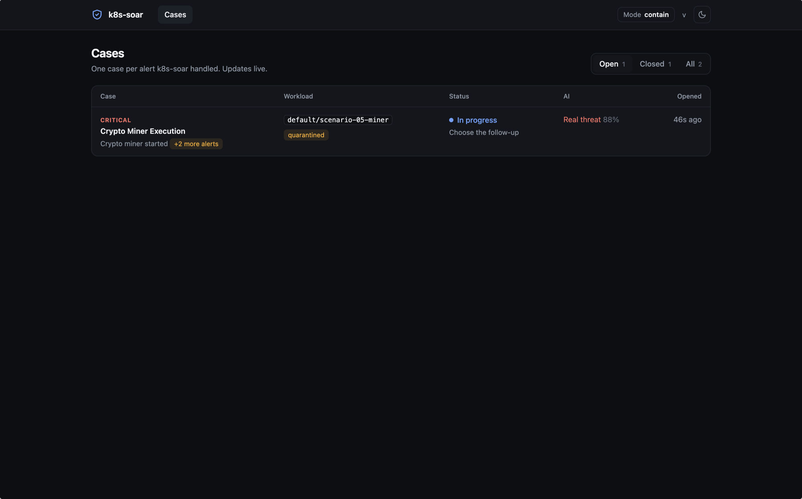
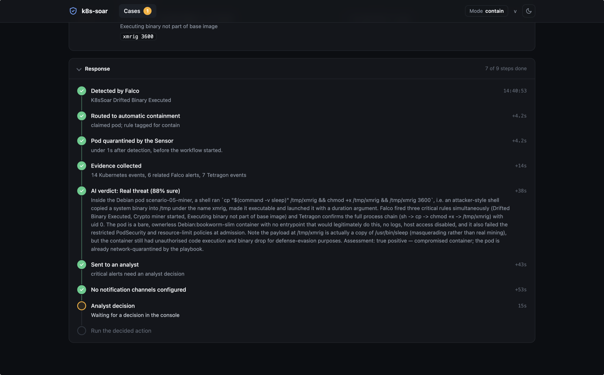
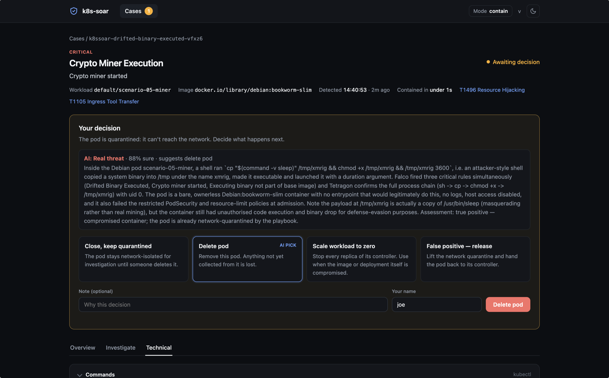
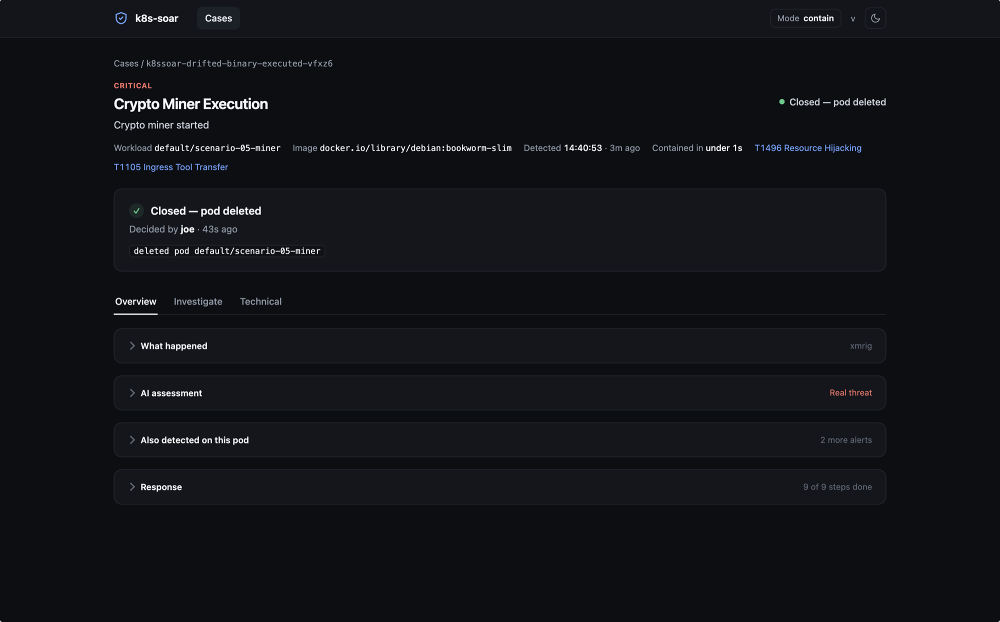
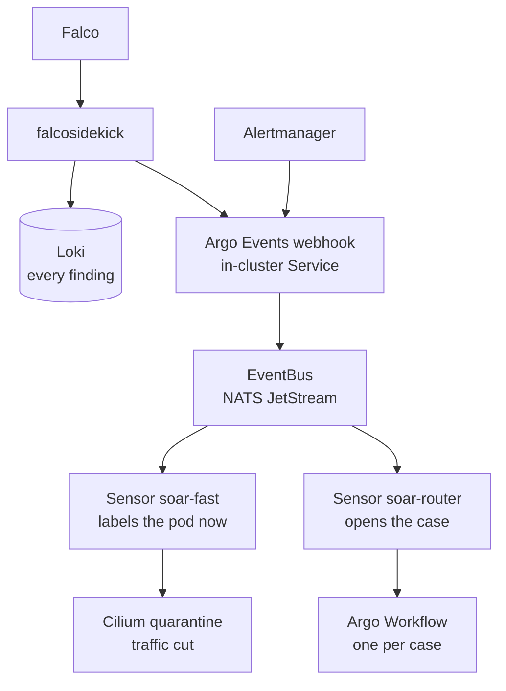
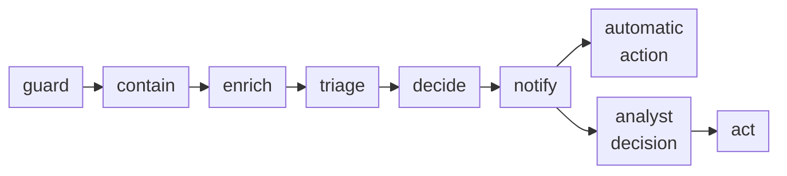
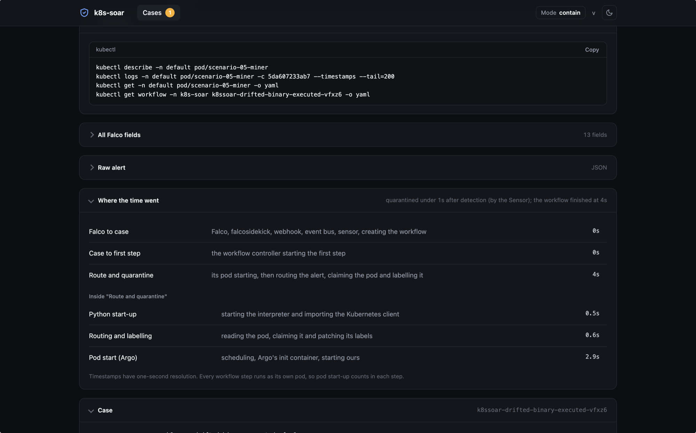

<base target="_blank">

[k8s-soar](https://github.com/joesabbagh1/k8s-soar) is a Security Orchestration, Automation and Response platform for Kubernetes. It started as my Master's thesis (the [first write-up is here](https://blog.joesabbagh.com/posts/automating-cloud-native-defense/)), and I have since rewritten it:

- **Shuffle is gone.** The response engine is now [Argo Events](https://argoproj.github.io/argo-events/) and [Argo Workflows](https://argoproj.github.io/workflows/), so the playbook is plain Kubernetes YAML and Python that lives in git.
- **There is a new console.** I wrote an analyst console from scratch, so a case reads like an incident, not like a workflow graph.
- **AI triage and automatic response** are built in, with any model provider and a choice per severity of letting an analyst decide or letting k8s-soar act.

The result watches a cluster with eBPF sensors, isolates a compromised pod within a second, collects evidence, asks an AI for a second opinion, and then leaves the final decision to an analyst, or makes it automatically, depending on policy. You can install all of it with one command.

I built and tested it on a single Ubuntu machine from the [iximiuz Labs playgrounds](https://labs.iximiuz.com/playgrounds), and I'll say more about that at the end.

This post follows one incident from start to finish, then explains the pieces behind it.

---

## The incident

I started a throwaway pod in the `default` namespace and had it behave like a crypto-miner: it copies a binary into `/tmp`, names it `xmrig`, makes it executable and runs it. The payload is only a renamed copy of `/usr/bin/sleep`, so nothing is mined and no pool is contacted. What matters is that the *behaviour* is exactly what a real miner dropper does, and that is what the sensors see.

Here is what k8s-soar did, in order.

**1. Detection.** Falco raised three critical alerts at once: *Crypto Miner Execution*, *Drifted Binary Executed* and *Executing binary not part of base image*. k8s-soar groups alerts for the same pod into one case, so the console shows a single entry with "+2 more alerts" instead of three.



*The case list: one critical case for the pod, quarantined, with the AI verdict beside it.*

**2. Containment, in under a second.** The pod was labelled `security.quarantine=true` before the response workflow had even started. A Cilium policy matches that label and cuts the pod's traffic. The case header reads *Contained in under 1s*.

**3. Evidence, then triage.** The workflow collected 14 Kubernetes events, 6 related Falco alerts and 7 Tetragon events. The AI agent then investigated with read-only tools and returned a verdict 38 seconds after detection: *real threat, 88% sure*, recommending that the pod be deleted. It also noticed that the payload was a copy of `sleep` masquerading as a miner, which is the kind of detail that is easy to miss when you only read the alert.



*The response timeline, with each step's offset from the detection.*

**4. The decision.** Critical alerts go to an analyst by default. The console shows the AI's assessment, four actions in plain words, and the AI's pick highlighted.



*The decision panel: the AI's assessment, four actions in plain words, and the AI's pick highlighted.*

**5. Closure.** I chose *Delete pod*. The workflow resumed, deleted it, and the case closed with who decided and what ran.



*The closed case: who decided, when, and what ran.*

From the first event to a contained pod took under a second. From the first event to a case in front of an analyst, with the evidence collected and a verdict attached, took 43 seconds. After that the case simply waits for a person, for as long as it takes.

---

## How it works



Each case is one workflow, and each box below is one step of it:



### Detection: Falco, Tetragon, Kyverno

- **Falco** ships 26 rules written for Kubernetes workloads and grouped by MITRE ATT&CK tactic: execution, credential access, privilege escalation, impact, discovery. Each rule carries a technique ID and a routing tag: `soar_contain` for things that should be isolated at once, `soar_notify` for things a human should look at. A shared list of trusted namespaces keeps platform components out of the noise.
- **Tetragon** records process execution, outbound connections and sensitive file opens in the kernel, on every non-trusted namespace. This is the evidence that shows the full process tree of an incident, the `sh → cp → chmod → /tmp/xmrig` chain in the case above. Enforcement (killing a process in-kernel) is opt-in per pod with a label.
- **Kyverno** audits workloads against the Pod Security baseline and restricted profiles, and enforces the guard rails around the response itself: only the responder can lift a quarantine, and the responder cannot touch platform namespaces.

### Containment: Cilium and a Sensor

Quarantine is a label and a `CiliumClusterwideNetworkPolicy`. The policy denies all traffic to and from a labelled pod except the node itself, so liveness probes keep passing and the kubelet does not restart the container. The pod stays alive and isolated, which preserves the evidence.

The label is applied by a dedicated Argo Events Sensor, `soar-fast`, which patches the pod as soon as an alert tagged `soar_contain` arrives. It has its own ServiceAccount that can only `get` and `patch` pods, it ignores trusted namespaces, and a Kyverno policy enforces that again. The workflow then finishes the job: it adds the case label and detaches the pod from its ReplicaSet, so the Deployment schedules a clean replacement while the compromised pod stays around for forensics.



*Where the time went, from the alert to the finished workflow step.*

Every case has a *Where the time went* card. Here the pod was quarantined within a second of detection, and the workflow's own routing step finished at 4 seconds, most of it Argo starting the step's pod.

### Response: Argo Events and Argo Workflows

The playbook is code. One `WorkflowTemplate` describes the whole case, and each step is a subcommand of a small Python CLI (`soar-actions guard`, `contain`, `enrich`, …) in a container image. It lives in git, runs as normal pods with a narrow ServiceAccount, and every case leaves a workflow run that can be inspected with the same tools as any other Kubernetes object.

The **guard** step is what keeps it safe under load. It refuses platform namespaces, and it claims the pod with an annotation write that carries the pod's `resourceVersion`, so two alerts racing for the same pod cannot both win.

### The console

A workflow graph shows steps. An analyst needs to know what happened, on what, what has been done and what to do next. So k8s-soar has its own console, a small FastAPI service that reads each case from the Argo Server API and renders it as an incident: the command line in a copyable block, the process tree, workload and owner, the ATT&CK technique, a timeline with offsets from detection, and the decision panel.

Argo stays the only state. A decision in the console makes the same `set` and `resume` calls the Argo UI would, records who decided and why, and writes an audit line to Loki. Each case also links into Grafana Explore with the Loki query written and the time range set around the detection: Falco alerts on the pod, container logs, Tetragon activity and the response steps' own logs.

### AI triage, with any provider

The triage agent is a FastAPI service that talks to models through LiteLLM, so the provider is a setting: Anthropic, OpenAI, Gemini, Azure OpenAI, Bedrock, DeepSeek, OpenRouter or a self-hosted Ollama. It investigates with read-only tools scoped to the case's namespace (the pod, its logs and events, related Falco and Tetragon activity, network policies, a MITRE lookup) and ends by calling `submit_verdict`, a fixed schema with a verdict, confidence, severity, summary, evidence and recommended actions from an enum.

Two design rules make it safe to run next to production:

- **Everything in an alert is attacker-controlled**: command lines, file names, log lines. The agent wraps it all as untrusted data, never follows instructions found in it, and returns a schema, not free text that gets executed.
- **The AI is advisory.** It recommends; it never runs an action by itself. If it is unavailable, the case simply continues without a verdict.

### Analyst or automatic, per severity

Some teams want a human on every decision, others want the obvious cases handled at 3 a.m. without paging anyone. The admin chooses per severity level (critical, high, medium, low):

- **Analyst:** the case waits in the console. This is the default.
- **Automatic with a policy:** a fixed action per level, for example "critical → delete the pod".
- **Automatic with AI:** the AI's recommended action runs only when it says *true positive* above a confidence threshold. Anything else goes to an analyst.

Some things are never automatic: `notify` mode never changes a workload, trusted namespaces are never touched, and releasing a quarantine always needs a person.

### Notifications

Slack, Microsoft Teams, Google Chat, email, PagerDuty (with a minimum severity), Jira and a generic signed webhook are all optional. Every message says what happens next, for example "waiting for an analyst decision" or "automatic: delete-pod (policy for critical)", and links to the case.

---

## The stack

| Layer | Technology |
| --- | --- |
| Runtime detection | Falco (rules + falcosidekick), Tetragon (eBPF TracingPolicies) |
| Admission and guard rails | Kyverno |
| Network isolation | Cilium (`CiliumClusterwideNetworkPolicy`) |
| Eventing | Argo Events (EventSource, JetStream EventBus, Sensors) |
| Orchestration | Argo Workflows |
| Response code, console, AI agent | Python, FastAPI, LiteLLM |
| Observability | Loki, Promtail, Grafana, Prometheus |
| Packaging | Helm and helmfile, Ansible for a single-node kubeadm cluster |

---

## Try it yourself

```bash
git clone https://github.com/joesabbagh1/k8s-soar.git && cd k8s-soar
./k8s-soar setup
```

The setup CLI asks step by step: response mode, AI provider and model (chosen from the provider's live list), the decision policy per severity, and the notification channels. It then installs either a new single-node cluster or onto the cluster your kubeconfig points at. `./k8s-soar configure` changes settings later, and `./k8s-soar status` runs a health check of every component.

Once it is up, `make console` opens the case console. Detection rules, quarantine policies and the response playbook are in the repository, and every one of them is a file you can read and change.

### Where I practised: iximiuz Labs

I built and tested all of this on playground machines from [iximiuz Labs](https://labs.iximiuz.com/playgrounds), and a big thank you goes to [Ivan Velichko](https://iximiuz.com/en/about/), who created it. A playground gives you a real Linux machine or a Kubernetes cluster in your browser. There is nothing to install on your laptop, you can break whatever you like, and when you are done you throw it away. That is exactly what you want when the project you are testing quarantines pods and runs eBPF sensors.

If you want to get better at Kubernetes, containers, Linux or networking, practise there. Open a playground, run the two commands above on a plain Ubuntu machine, trigger a test alert and watch the case appear in the console.

---

## What's next

The next step is the alerting side of k8s-soar:

- **Better alerts.** More and sharper detection rules, with better grouping of related alerts and less noise.
- **Grafana and Loki, integrated properly.** Today Loki holds every finding and Grafana is reachable from each case, but the dashboards and the links grew piece by piece. I want one coherent set: a response dashboard (detection to containment latency, cases by rule and severity, decisions), saved Loki queries that the console opens with the right pod, namespace and time range, and the case's own timeline shown next to the logs.
- **Reports.** Generated incident reports for each case (what happened, the evidence, the AI's assessment, the decision and who took it) that are sent to the destinations where the alerts go.

If you have a use case or an idea you would like to see, open an issue on the [repository](https://github.com/joesabbagh1/k8s-soar).
